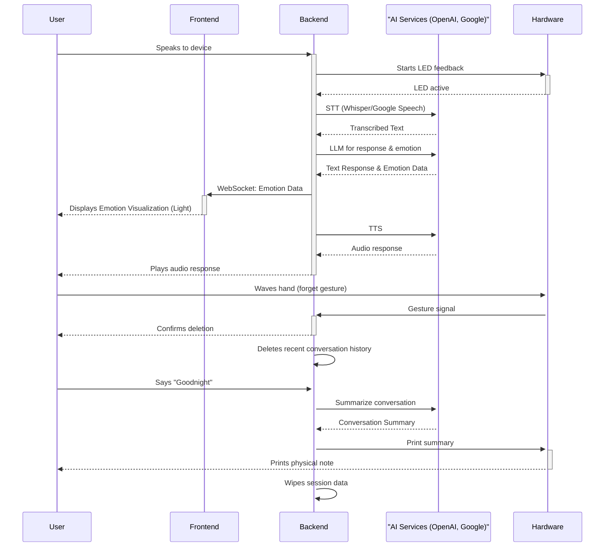

# Oblivilight

An intelligent night lamp that provides a safe, ephemeral space for users to voice their thoughts and emotions, converting conversations into physical paper notes.

[](https://path-to-your-award-or-project-page)
[](https://path-to-conference-page)

---

## Overview

In an era where personal AI companions collect vast amounts of user data, Oblivilight explores a new paradigm of privacy-centric interaction. This project addresses the user's need for a safe emotional outlet without creating a permanent digital record that could be misinterpreted or misused. Oblivilight is an AI-powered night lamp that engages users in conversation, visualizing the emotional tone of the discussion through ambient colored light. Users can instantly erase parts of a conversation with a simple hand gesture. At the end of the session, the lamp prints a physical summary of the dialogue on a small note, effectively transferring the memory from a vulnerable digital state to a private, tangible artifact. This tangible interaction model empowers users with complete control, transforming data deletion into a deliberate and therapeutic ritual of letting go.

## Features

*   **Voice-Activated Dialogue:** Users can initiate conversations naturally to share their thoughts and feelings before sleep.
*   **Real-time Emotion Visualization:** The lamp’s light shifts in color and intensity to reflect the emotional sentiment of the user's voice, providing empathetic, non-verbal feedback.
*   **Gesture-Based Deletion:** A simple wave of the hand over the lamp erases the current part of the conversation, offering immediate, intuitive control over the AI’s memory.
*   **Tangible Memory Creation:** At the end of a session (e.g., saying "Goodnight"), the lamp prints a physical "memory slip" containing a summary of the conversation, the date, and a visual of the emotional lightscape.
*   **Privacy-by-Design:** Once the memory is printed, it is wiped from the system, ensuring the user's thoughts remain private and under their physical control.
*   **Physical Memory Archive:** Users can choose to discard the printed notes or save them in a physical journal, creating a tangible collection of memories they can review offline.

## Technical Architecture

Oblivilight is a full-stack project combining a web interface, a powerful backend, and custom hardware.



### Frontend

The frontend is a web-based interface for displaying the emotional state visualization.

*   **Framework:** [Next.js](https://nextjs.org/) (using Turbopack)
*   **Language:** JavaScript (React)
*   **Styling:** [Tailwind CSS](https://tailwindcss.com/)

### Backend

The backend handles the core logic, including voice processing, AI conversation, and hardware control.

*   **Framework:** [FastAPI](https://fastapi.tiangolo.com/)
*   **Language:** Python
*   **AI & Machine Learning:**
    *   **Conversation:** [OpenAI GPT](https://openai.com/), [LangChain](https://www.langchain.com/)
    *   **Speech-to-Text:** [OpenAI Whisper](https://openai.com/research/whisper), [Google Cloud Speech-to-Text](https://cloud.google.com/speech-to-text)
    *   **Text-to-Speech:** OpenAI TTS, Yating 
*   **Communication:** WebSockets for real-time communication with the frontend.
*   **Hardware Interface:** `PySerial` for communicating with the Arduino.

### Hardware

The physical lamp is controlled by an Arduino, which manages the sensors and actuators.

*   **Microcontroller:** [Arduino](https://www.arduino.cc/)
*   **Key Components:**
    *   Gesture Sensor (for deletion)
    *   LEDs (for emotion visualization)
    *   Thermal Printer (for printing memory slips)
*   **Communication:** Serial communication with the Python backend via `arduino_gateway.py`.

## Getting Started

### Prerequisites

*   Python 3.8+
*   Node.js and Yarn
*   Arduino IDE (for flashing the microcontroller)

### Installation

1.  **Clone the repository:**
    ```bash
    git clone https://github.com/your-username/OpenHCI25-Oblivilight.git
    cd OpenHCI25-Oblivilight
    ```

2.  **Backend Setup:**
    ```bash
    # Create and activate a virtual environment
    python3 -m venv venv
    source venv/bin/activate

    # Install dependencies
    pip3 install -r backend/requirements.txt
    ```

3.  **Frontend Setup:**
    ```bash
    cd frontend
    yarn install
    cd ..
    ```

4.  **Hardware Setup:**
    *   Connect the Arduino to your computer.
    *   Open `hardware/arduino/sketch_jul18a/sketch_jul18a.ino` in the Arduino IDE.
    *   Upload the sketch to your Arduino board.

### Running the Application

1.  **Start the Backend:**
    ```bash
    python3 -m backend.main
    ```
    The backend server will start, typically on `localhost:8000`.

2.  **Start the Frontend:**
    In a new terminal:
    ```bash
    cd frontend
    yarn run dev
    ```
    The frontend development server will start, typically on `localhost:3000`.

3.  **Run the Hardware Gateway:**
    The backend should automatically handle communication with the Arduino via `arduino_gateway.py`. Ensure your Arduino is connected to the correct serial port.

## Project Structure

```
.
├── backend/         # Python FastAPI backend
│   ├── core/        # Core application logic (agent, chains, state)
│   ├── services/    # Services for audio, STT, TTS
│   └── main.py      # Main application entry point
├── frontend/        # Next.js frontend
│   ├── src/
│   │   ├── app/     # Main page components
│   │   └── components/ # Reusable React components
│   └── public/      # Static assets and videos
├── hardware/        # Hardware code and utilities
│   ├── arduino/     # Arduino sketches
│   └── arduino_gateway.py # Python script to interface with Arduino
└── README.md
```
